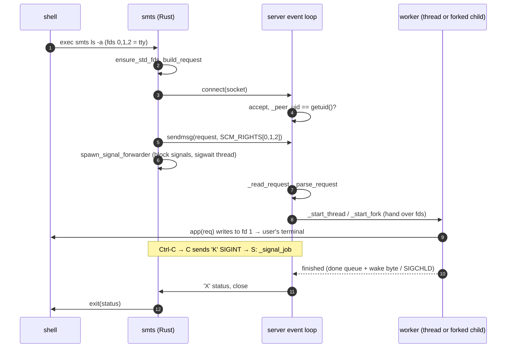

# Architecture

This document explains how `smts-ipc` works: the processes involved, the wire
protocol, how one command flows through the system, and why it is built this
way. Symbols are cited as `file::symbol` so they can be found with grep:

- `main.rs` = `client/src/main.rs`
- `server.py` = `server/smts_server.py`
- `app.py` = `server/example_app.py`

## 1. The problem and the idea

A Python CLI pays interpreter startup plus module imports on **every**
invocation. That is ~20–30 ms for a trivial script, and hundreds of
milliseconds to seconds once numpy, torch or similar are imported. The fix is
to pay that cost once:

- A **long-lived Python server** imports everything at startup and waits on a
  Unix domain socket.
- A **tiny native client** (Rust, ~400 KB, starts in about 1 ms) is what the
  user actually runs. It forwards the invocation to the server and exits
  with the server's answer.

The central design decision is how the command's input and output travel. The
client does **not** relay stdout/stderr through the socket. It sends its own
stdin, stdout and stderr *file descriptors* to the server (`SCM_RIGHTS`), and
the command reads and writes them directly. The socket only carries the
request and, at the end, the exit status.

```
 user's shell
     │ fork+exec
     ▼
 ┌────────────────┐   1. request frame + SCM_RIGHTS [fd0, fd1, fd2]  ┌──────────────────────┐
 │ smts (Rust)    │ ───────────────────────────────────────────────▶ │ smts_server.py       │
 │                │   2. 'K' frames (forwarded Ctrl-C etc.)          │  (warm, imports done)│
 │ waits for 'X'  │ ───────────────────────────────────────────────▶ │                      │
 │                │ ◀─────────────────────────────────────────────── │  runs app(req)       │
 └────────────────┘   3. 'X' exit status                             └──────────┬───────────┘
        ▲                                                                       │
        └──── terminal / pipe / file ◀────── command writes to the SAME ────────┘
                                             open files the shell gave the client
```

What this buys: `isatty()` is true when it should be, colours and progress
bars work, `smts x | head` gets a real `EPIPE`, `smts x < file` reads the file,
and output is never delayed by an extra copy through the socket.

## 2. Components

| Component | Language | Lifetime | Responsibility |
|---|---|---|---|
| `client/` → `smts` | Rust, `libc` only | one invocation | collect argv/cwd/env, connect (auto-start), pass fds, forward signals, exit with the status |
| `server/smts_server.py` | Python ≥ 3.9, stdlib only | long-lived | socket, auth, protocol, scheduling, running commands (thread or fork mode), shutdown |
| `server/example_app.py` | Python | loaded once by the server | the *command processor*: argparse subcommands; stands in for SMTS |
| `server/bench.py`, `test.sh`, `Makefile` | — | dev tooling | benchmarks, end-to-end tests, build/run targets |

The server is generic. It knows nothing about the commands; it calls one
function:

```python
App = Callable[[Request], Optional[int]]   # server.py::App
```

Everything specific to SMTS lives behind that function (`app.py::main` in the
example), selected with `--app module:callable` (`server.py::_load_app`).

## 3. Wire protocol

Transport: `AF_UNIX`, `SOCK_STREAM`. Every message is a length-prefixed frame:

```
frame = u32 length (big-endian) ‖ payload[length]
```

`SOCK_STREAM` was chosen over `SOCK_DGRAM` because the request can be large
(the environment alone is often several KB, beyond macOS's default 2 KB
datagram limit), and we need a connection whose closure signals that the
client died.

### 3.1 Request (client → server, once)

```
"SMTS" ‖ u8 version=1 ‖ u8 kind
kind 'R' (run):
    u32 argc ‖ { u32 len ‖ bytes }×argc        argv, including argv[0]
    u32 len  ‖ bytes                           cwd (getcwd(), physical path)
    u32 envc ‖ { u32 len ‖ "KEY=VALUE" }×envc  full environment
kind 'S' (stop), 'P' (status): no body
```

Built by `main.rs::build_request` and parsed by `server.py::_parse_request`
(using `_Cursor` for bounds-checked reads; truncation raises `ProtocolError`).

Strings travel as **raw bytes**, not UTF-8 or JSON, because on Unix argv,
paths and environment values are arbitrary byte strings. The server decodes
them with `os.fsdecode` (surrogateescape), the same decoding CPython applies
to its own `sys.argv`, so a non-UTF-8 filename survives the round trip.

The three file descriptors are attached as an `SCM_RIGHTS` control message
to the **first** `sendmsg()` (`main.rs::send_with_fds`). Any remaining bytes
of a large request go out with a plain `write_all`. On the server,
`server.py::_read_request` uses `socket.recv_fds(conn, 65536, 3)`, so the
ancillary data is collected together with the first chunk. If
`MSG_CTRUNC` is set (fds were dropped), the request is rejected.

### 3.2 While a command runs (client → server)

```
'K' ‖ i32 signum        forward a signal the client received
```

### 3.3 Replies (server → client)

```
'X' ‖ i32 status        command finished; client exits with this status
'E' ‖ utf-8 message     request rejected (bad magic, version mismatch, missing fds, …)
'I' ‖ json              reply to 'P' (status)
```

### 3.4 Limits and versioning

| Limit | Value | Where |
|---|---|---|
| request size | 16 MiB | `server.py::MAX_REQUEST` |
| response frame size | 1 MiB | `main.rs::MAX_RESPONSE` |
| time to send the request after connecting | 5 s | `server.py::REQUEST_TIMEOUT` |
| fds per request | exactly 3 | `server.py::Server._accept` |

A version mismatch is reported to the user, not silently misparsed:
`_parse_request` raises *"client speaks protocol vN, server vM"*, which the
client prints and exits with 70. Bump `VERSION` / `PROTOCOL_VERSION` together
whenever the frame layout changes.

## 4. Lifecycle of one command



### 4.1 Client side (`main.rs`)

1. **`ensure_std_fds`**: if the client was started with fd 0, 1 or 2 closed
   (`smts <&-`), opens `/dev/null` into the gap. There must always be exactly
   three valid fds to send.
2. **`socket_path`**: `$SMTS_SOCKET`, otherwise
   `$XDG_RUNTIME_DIR | $TMPDIR | /tmp` + `smts-<uid>.sock`. This must stay
   identical to `server.py::default_socket_path`.
3. **`build_request`**: the frame from §3.1, built before connecting, so a
   cwd error (directory deleted under the shell) is reported without touching
   the server.
4. **`connect_or_start`**: see §7.
5. **`send_with_fds`**: `sendmsg(2)` with a hand-built `cmsghdr`. The control
   buffer is a `Vec<u64>` so that it is aligned for `cmsghdr`.
   `msg_iovlen`, `msg_controllen` and `cmsg_len` have different integer types
   on Linux and macOS, hence the `as _` casts.
6. **`spawn_signal_forwarder`**: see §6. Done *after* connecting so an
   auto-started server does not inherit a blocked signal mask.
7. **`read_frame`** loop: `X` → `process::exit(status)`; `E` → print, exit 70;
   EOF without `X` → *"server closed the connection without reporting an exit
   status"*, exit 70.

Client exit statuses:

| Status | Meaning |
|---|---|
| whatever the command returned | normal case |
| 69 (`EX_UNAVAILABLE`) | no server and no auto-start, or the server failed to start |
| 70 (`EX_SOFTWARE`) | protocol or I/O error, or an `'E'` reply |
| 128+N | gave up after the third signal N (§6) |

### 4.2 Server side (`server.py::Server`)

`serve_forever` sets up, in order:

1. **`_acquire_lock`**: `flock(LOCK_EX|LOCK_NB)` on `<socket>.lock`. If it is
   already held, raise `AlreadyRunning`, which `main` treats as success (exit
   0) so that two clients auto-starting at once do not report an error.
2. A **wake socketpair** (`_wake_r`, `_wake_w`, both non-blocking).
3. **`_bind`**: unlink any stale socket (safe, since we hold the lock), set
   `umask(0o177)`, `bind`, restore the umask, `listen(64)`. The socket file is
   born with mode 0600; there is no window where it is world-accessible.
4. A `selectors.DefaultSelector` (epoll on Linux, kqueue on macOS) watching:
   - the listener (`data="accept"`)
   - `_wake_r` (`data="wake"`)
   - one connection per running job (`data=<_Job>`)
5. `signal.set_wakeup_fd(_wake_w)`, a no-op `SIGCHLD` handler (a Python
   handler must be installed or the wakeup fd is never written), and
   `_on_stop_signal` for `SIGTERM`/`SIGINT`/`SIGHUP`.
6. In thread mode, replace `sys.stdin/stdout/stderr` with `_RoutedStream`s (§5.1).

The loop is **single-threaded**. Only worker threads (in thread mode) run
concurrently with it, and they talk to it through `_done` (a `SimpleQueue`)
plus one byte on `_wake_w` (`_wake`). Keeping the loop single-threaded is
also what makes `fork()` safe in fork mode: when the server forks, no other
thread can be holding a lock.

`_accept` handles one connection:

1. `accept()`, then **`_peer_uid`**: `SO_PEERCRED` on Linux, or
   `getpeereid()` through ctypes on macOS/BSD. Connections from any other uid
   are closed silently. This matters because a command runs with the
   server's privileges on the caller's fds.
2. `_read_request` with a 5 s timeout. It returns `(payload, fds, leftover)`.
   `leftover` holds bytes that arrived after the request (a Ctrl-C pressed
   immediately), which become the job's initial `rbuf`.
3. Dispatch by kind:
   - `'S'`: reply `X 0`, then `_begin_stop`.
   - `'P'`: reply `I {pid, mode, socket, running, served, uptime_s}`.
   - `'R'` with three fds: create a `_Job`, register its connection, then
     `_start_thread` or `_start_fork`, then process `leftover`.
   - Anything else: reply `E`, close the fds.

While a job runs, its connection stays registered. `_on_client_readable`
parses `'K'` frames (`_process_client_frames` → `_signal_job`). **EOF**
means the client died without sending a signal (for example it was
`SIGKILL`ed), so the job gets `SIGTERM` and is marked `client_gone`. When it
finishes, nobody is waiting for a reply.

`_finish` unregisters the connection, sends `X status` through `_reply`, and
closes it.

## 5. Execution modes

Both modes give the app the same `Request`:

```python
Request(argv, cwd, env, stdin, stdout, stderr, cancelled, signal)   # server.py::Request
req.path(p)            # os.path.join(req.cwd, p)
req.check_cancelled()  # raise KeyboardInterrupt if the client forwarded a signal (thread mode)
```

`_wrap_fds` builds text streams that mimic CPython's own stdio:
- UTF-8 everywhere.
- stdin and stdout use `surrogateescape`; stderr uses `backslashreplace`.
- stdout is line-buffered only when it is a tty; stderr is always line-buffered.

`_invoke` turns whatever the app does into a CLI exit status:

| App behaviour | Status |
|---|---|
| returns `int` / `None` | that int / 0 |
| `SystemExit(code)` (`sys.exit`, argparse errors, `--help`) | `code` (a str is printed, then 1) |
| `KeyboardInterrupt` | 130 |
| `BrokenPipeError` (`… \| head`) | 141 |
| any other exception | traceback to the **client's** stderr, then 1 |

`stdout` is flushed afterwards, ignoring a broken pipe.

### 5.1 Thread mode (default)

`_start_thread` wraps the received fds with `closefd=True` (the server now owns
those fd copies), decodes the environment to `str`, builds the `Request`, and
starts a daemon thread running `_thread_main`.

```
server process (one, long-lived)
 ├─ main thread: event loop
 ├─ smts-7: app(req)  → writes to the client's fd copy
 └─ smts-8: app(req)  → writes to another client's fd copy
```

Process-global state cannot be changed per request, which leads to two rules:

- **cwd and environment.** The server `chdir("/")`s at startup (`main`), so a
  stray relative `open()` fails loudly instead of silently reading the
  server's directory. Commands must use `req.cwd`, `req.path()` and
  `req.env`.
- **`sys.std*`.** These are replaced by `_RoutedStream` proxies. Every
  attribute access goes through `__getattr__` to
  `getattr(_local, name) or fallback`. `_thread_main` stores the request's
  streams in the thread-local `_local`, so `print()`, `input()`, argparse's
  help and error output, and `logging.StreamHandler(sys.stderr)` all reach the
  right client. The event loop's own `_log` writes to `_fallback`, the real
  server stderr.

**Cancellation.** A thread cannot be interrupted from outside, so
`_signal_job` only sets `req.signal` and `req.cancelled`. Long-running
commands must poll; `app.py::cmd_sleep` waits on `req.cancelled` instead of
calling `time.sleep`.

When done, `_thread_main` clears `_local`, closes the streams (dropping the
server's fd copies), puts the job on `_done` and wakes the loop.

### 5.2 Fork mode

`_start_fork` flushes the server's own stdio (otherwise buffered bytes would
be duplicated into the child), calls `os.fork()`, closes the parent's copies
of the received fds, and records `pid → job` in `_by_pid`.

```
server process (parent, event loop)
 ├─ child 4711: real chdir, real env, fds 0/1/2 = client's  → app(req) → os._exit(rc)
 └─ child 4712: …
```

The child (`_child_main`) runs these steps and never returns:

1. Resets signals: `set_wakeup_fd(-1)`; `SIGCHLD`, `SIGTERM` and `SIGHUP` to
   `SIG_DFL`; `SIGINT` to `default_int_handler` (so Ctrl-C raises
   `KeyboardInterrupt`).
2. Closes server-only fds: the listener, the wake pair, **every** job
   connection including its own, and the lock fd. The selector is left alone:
   a kqueue is not inherited across `fork()` on macOS, so closing it could hit
   an unrelated fd number.
3. `dup2(fd_i, i)` for i = 0, 1, 2, then closes the originals. The command
   now has the client's terminal or pipes as its *real* stdio.
4. `os.environb` is replaced with the client's environment, `sys.std*` are
   rewrapped over 0/1/2 (`closefd=False`), `sys.argv` is set, and it calls
   `os.chdir(cwd)`.
5. `_invoke`, flush, then **`os._exit(rc & 0xFF)`**. `_exit` skips the
   inherited `atexit` handlers and buffered state, which belong to the parent.

The parent learns about completion through `SIGCHLD` → wakeup byte →
`_on_wake` → `_reap_children` (`waitpid(-1, WNOHANG)` in a loop).
`os.waitstatus_to_exitcode` returns `-N` for death by signal N, which is
mapped to the shell convention `128+N`. Signals from the client are delivered
for real with `os.kill(pid, signum)`.

### 5.3 Choosing a mode — trade-off

| | thread | fork |
|---|---|---|
| warm state (caches, loaded models) | shared and **persistent** | copy-on-write snapshot; changes are lost when the child exits |
| app code style | must use `req.*` | ordinary CLI code works |
| Ctrl-C | cooperative (`req.cancelled`) | preemptive (`KeyboardInterrupt` anywhere) |
| crash isolation | segfault / `os._exit` kills the server | only the child dies |
| CPU-bound concurrency | one GIL | true parallelism |
| safety after threads / CUDA / ObjC frameworks are loaded | safe | **unsafe**: fork without exec copies locks held by other threads; CUDA contexts and Apple frameworks (Accelerate, PyObjC) do not survive `fork()` |
| measured overhead (Linux VM, `echo`) | ≈ 2.5 ms | ≈ 7.5 ms |

Neither mode is better in general. Thread mode is the default because it stays
correct once an ML/CV stack or PyObjC is loaded, and because persistent warm
state is usually the reason for having a server at all.

## 6. Signals

**Client.** Before waiting, `spawn_signal_forwarder` blocks
`SIGINT`/`SIGTERM`/`SIGHUP`/`SIGQUIT` with `pthread_sigmask` and starts a
thread that receives them **synchronously** with `sigwait()`. That thread
writes a `'K' signum` frame to a cloned socket handle. This avoids
async-signal-safety problems entirely, since no code runs inside a signal
handler.

If the server stops reacting (a stuck thread-mode command that never checks
`req.cancelled`), the **third** signal makes the client exit with
`128+signum`, so the user is never trapped.

**Server parent.** The first `SIGTERM`/`SIGINT`/`SIGHUP` calls `_begin_stop`:
stop accepting, unlink the socket, let running jobs finish, then exit. A
second signal raises `SystemExit` immediately, and `_cleanup` sends `SIGTERM`
to remaining children.

**Ordering detail.** A signal can arrive before the server has even
dispatched the job: the `'K'` frame is then in `leftover` and is processed
right after `_start_*`, so it is not lost.

## 7. Auto-start, locking, stale sockets

`main.rs::connect_or_start`:

1. `connect()`. On `ENOENT` (no socket file) or `ECONNREFUSED` (stale socket
   file, nobody listening), fall through.
2. If `SMTS_SERVER_CMD` is unset, exit 69 with a hint.
3. Otherwise spawn `/bin/sh -c "$SMTS_SERVER_CMD"`:
   - in a new session (`setsid` in `pre_exec`), so it survives the terminal;
   - with `cwd=/` and stdin from `/dev/null`;
   - with stdout and stderr appended to `<socket>.log`;
   - with `SMTS_SOCKET` exported so it binds where the client looks.
4. Poll `connect()` with exponential back-off (10 ms → 200 ms, up to 30 s).
   If the spawned shell exits non-zero, fail fast and point at the log. A zero
   exit means it lost the startup race to another instance (`AlreadyRunning`),
   so keep polling for the winner.

The server imports the app **before** binding (`main` → `_load_app` → `Server`).
A client therefore connects only once the server is fully warm, and the first
command does not wait for imports a second time.

The `flock` makes concurrent starts safe: exactly one server gets the lock,
and the lock holder may unlink a stale socket without a check-then-act race.
The lock is released by the kernel when the process dies, however it dies.

## 8. Ownership of file descriptors

Getting this wrong causes hangs: a pipe reader only sees EOF when **every**
writer has closed it.

| Holder | fds it holds | Released when |
|---|---|---|
| client `smts` | its own 0/1/2 | client exits after `X` |
| server, during `_read_request` | kernel-made duplicates from `SCM_RIGHTS` | — |
| thread mode | those duplicates, inside `_wrap_fds(closefd=True)` streams | `_thread_main`'s `finally` closes them |
| fork mode, parent | the duplicates | **immediately after `fork()`** (`_start_fork`) |
| fork mode, child | `dup2`'d onto 0/1/2 | `os._exit` |

For `smts ls | head -1`, the pipe has three potential writers: the client,
the server's copy, and the child (or thread). `head` closing early produces
`EPIPE` in the writer, which becomes `BrokenPipeError` and status 141. Python
ignores `SIGPIPE`, so it does not kill the server.

## 9. Security model

- **Who can connect:** the socket is mode 0600 and lives in a per-user
  location, and `_peer_uid` additionally rejects any uid other than the
  server's. The `SO_PEERCRED`/`getpeereid` credentials come from the kernel
  at `connect()` time and cannot be forged by the peer.
- **What a client gets:** the ability to run the configured app's commands as
  the same user, which the client could do anyway. The app is fixed at server
  start, so the client cannot choose arbitrary code.
- **Trust in the request:** argv, cwd and environment are attacker-*shaped*
  but come from the same user. They are parsed with bounds checks and a size
  cap and are never `eval`ed.

## 10. Known limitations and extension points

- **Unix only.** Windows `AF_UNIX` has no `SCM_RIGHTS`. A port would replace
  fd passing with stdin/stdout/stderr frames streamed over named pipes (or
  loopback TCP) and give up `isatty` transparency.
- **No controlling terminal** for the command: `/dev/tty`, `getpass`, and job
  control (Ctrl-Z suspends only the client) do not reach it. Forwarding
  `SIGTSTP`/`SIGCONT` as `'K'` frames would be a small extension.
- **Head-of-line blocking in `_accept`:** the request is read synchronously
  on the event loop (≤ 5 s timeout). A same-user client that connects and
  stalls delays others. A fix would register new connections and assemble
  requests incrementally, like `_on_client_readable` does.
- **Code reload** needs a restart (`make restart`). A version or mtime check
  in the `'P'` reply would let the client restart a stale server
  automatically.
- **Physical cwd:** the client sends `getcwd()`. The logical path the shell
  shows (through symlinks) is still available as `req.env["PWD"]`.
- **Protocol evolution:** add new request kinds or frame types and bump
  `VERSION`. Clients and servers of different versions fail with a clear
  message instead of misparsing.

## 11. Map of the code

```
client/src/main.rs
  main / run                     orchestration, exit statuses
  socket_path                    socket location rule (mirrors default_socket_path)
  build_request, put_u32/blob    request encoding
  connect_or_start, is_absent    connect + auto-start with back-off
  send_with_fds                  sendmsg + SCM_RIGHTS
  read_frame                     response decoding
  spawn_signal_forwarder         sigwait thread → 'K' frames
  ensure_std_fds                 plug closed 0/1/2 with /dev/null

server/smts_server.py
  Request, App                   public API for command processors
  default_socket_path            socket location rule
  _frame, _Cursor, _parse_request, _recv_exactly, _read_request    protocol
  _peer_uid                      SO_PEERCRED / getpeereid
  _wrap_fds, _invoke             stdio wrapping, exit-status semantics
  _local, _RoutedStream          per-thread sys.std* routing (thread mode)
  _Job                           per-connection state
  Server.serve_forever           setup + event loop
         ._acquire_lock/_bind    single instance, 0600 socket
         ._accept                auth, read, dispatch
         ._start_thread/_thread_main               thread mode
         ._start_fork/_child_main/_reap_children   fork mode
         ._on_wake/_on_client_readable/_process_client_frames/_signal_job/_finish
         ._on_stop_signal/_begin_stop/_cleanup     shutdown
  _load_app, _control, main      CLI: serve | stop | status

server/example_app.py
  PARSER (module level)          built once at server start
  main(req)                      parse req.argv[1:], dispatch to cmd_*
  cmd_echo/pwd/ls/wc/getenv/sleep/counter/info
```
